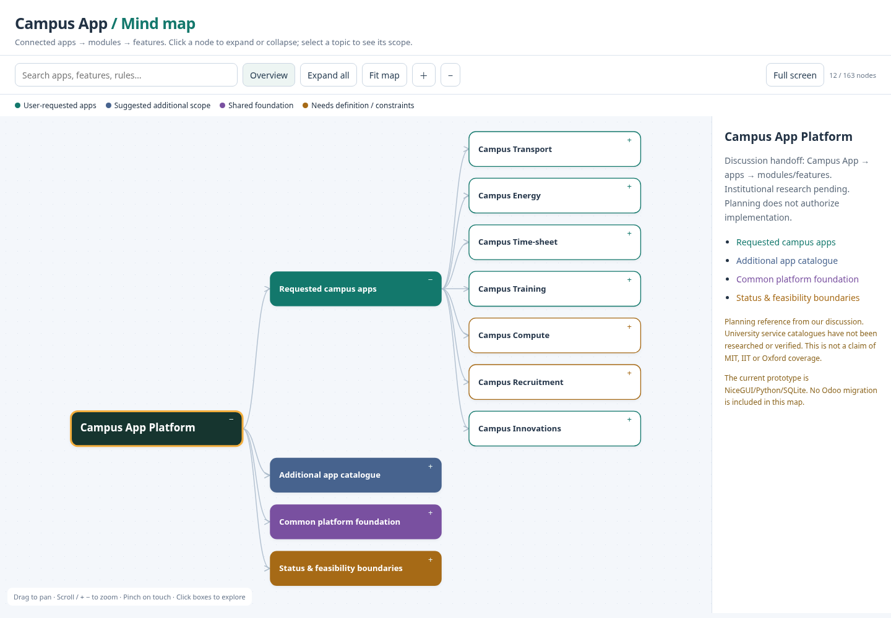
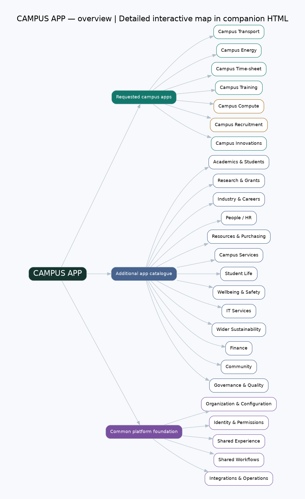
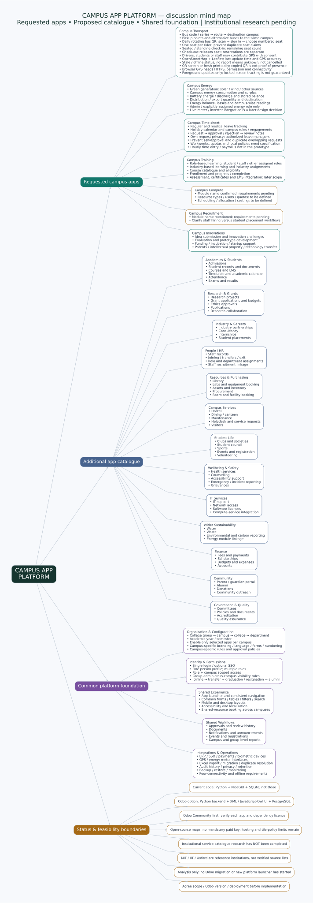

# Campus App — Visual Mind Map

**Campus App → apps → modules → features**, connected by arrows.

This is a planning handoff from our discussion. Green indicates user-requested apps, blue indicates proposed additional scope, purple indicates common platform services, and amber indicates requirements that still need definition. **MIT, IIT and Oxford service catalogues have not yet been researched or verified.** Inclusion in this map is not a claim that a feature is implemented.

## Open the map

- **[Full connected mind map — PDF](campus-platform-map.pdf):** open the PDF preview and zoom to read every feature; also suitable for downloading and sharing.
- **[Full connected mind map — SVG](campus-platform-map.svg):** scalable image with all app scopes and features.
- **[Interactive mind map — HTML](campus-platform-map.html):** download this file with GitHub's **Download raw file** button, then open it in a browser. Click nodes to expand/collapse, search for a topic, drag to pan, and scroll/pinch or use the buttons to zoom. Works offline; no account, server or external library is required. GitHub displays HTML source rather than running it.

The links above are repository documents, not a publicly deployed website. Access follows this repository's GitHub permissions. Keep the downloaded HTML local or share the file directly; publishing a hosted web page is a separate action.

## Interactive preview



## Connected overview



## Detailed map

Expand this section for a visual overview of every app's scope. For readable close-up viewing, open the PDF or SVG above.

<details>
<summary>Show the full connected map</summary>



</details>

## Status and scope

- **Existing prototype:** transport, manual energy ledger, leave workflows, role/industry training, and shared permissions in NiceGUI/Python/SQLite.
- **Names / requirements pending:** Compute and Recruitment; Compute has a placeholder screen.
- **Requested, not implemented:** Campus Innovations. Its proposed lifecycle is idea → evaluation → prototype → funding/incubation → startup/patent.
- **Proposed broader catalogue:** academics, research, industry relationships, HR, resources, services, student life, wellbeing, IT, sustainability, finance, community, and governance. These are suggestions, not approved implementation work.
- **Odoo:** an option under feasibility analysis; no migration has started. Odoo Community, custom-module scope, licences and deployment still need evaluation. The current app has not been replaced.
- **Hardware / mobile limits:** browser GPS is foreground-dependent, map tiles have service-use policies, and a daily QR needs a display or a new daily print. Physical-device testing remains necessary.

## Reuse in another chat or tool

Provide this repository and this document to the new chat. The hierarchy is also available as [JSON](campus-platform-map.json). It includes each topic's name, status, notes and children. This handoff is a requirements summary, not a complete conversation transcript.

Regenerate the diagrams with Python and Graphviz installed:

```bash
python docs/build_campus_map.py
```

The generator uses only the Python standard library plus the `dot` executable. The interactive HTML embeds its data and requires no network access.
